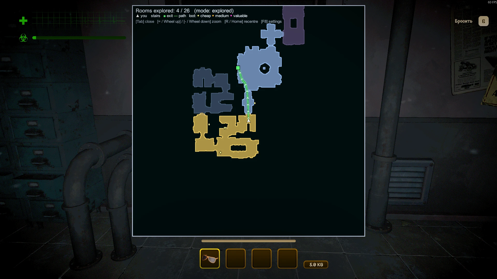
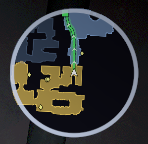
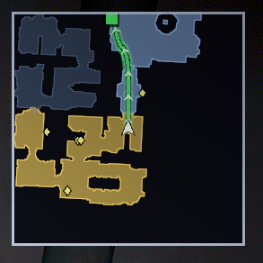
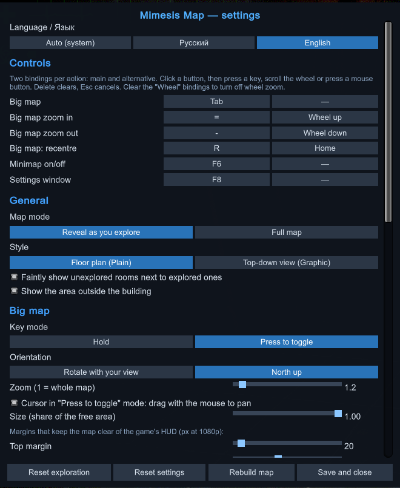
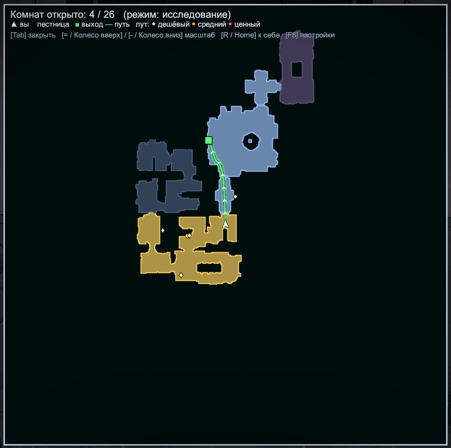

# MimesisMap

**English** | [Русский](#русский)

A building map and minimap for **MIMESIS**. The building is put together from prefab rooms every run, and remembering the way back is hard: MimesisMap draws what you have explored, room by room.

**Only you need it.** It is fully client-side: the host and other players don't need the mod.

## Screenshots



 



## Features

- **Map of the building, room by room.** A room appears as soon as you step into it, not only the area around you. Or switch to the **full map** from the start.
- **Exits**: building exits and entrance doors are marked, with the **shortest path to the nearest known exit** along the game's own navigation.
- **Minimap**: range, size, position, round or square, rotating with your view or north-up.
- **Big map** (hold Tab): opens centred on you, mouse wheel zoom, rotating or north-up, stays clear of the game's HUD. In press-to-toggle mode you can drag it with the mouse.
- **Stairs and floors**: staircases get an icon, other floors are dimmed.
- **Two styles**: clean floor plan (Plain) or a real top-down view with fog over unexplored rooms (Graphic).
- **Markers**: loot coloured by value; teammates and monsters (both off by default: teammate markers would give away mimics).
- **Shared exploration**: rooms where teammates have been open up too, and players who have the mod share their explored rooms through the Steam lobby. No host mod needed.
- Works in levels, the tram and the lobby.
- **Everything is set up in game**: press **F8**, or use the "Map (mod)" button in the game's settings window. English and Russian.

## Controls

Every action has a main and an alternative binding (keys, mouse wheel, mouse buttons), all changeable in the settings.

| Action | Main | Alternative |
|---|---|---|
| Big map (hold; press-to-toggle in settings) | Tab | — |
| Zoom in / out | = / - | Wheel up / down |
| Recentre the big map | R | Home |
| Minimap on/off | F6 | — |
| Settings window | F8 | — |

## Install

- **r2modman / Gale**: install [MimesisMap from Thunderstore](https://thunderstore.io/c/mimesis/p/StimDesu/MimesisMap/).
- **Manually**: install [MelonLoader](https://github.com/LavaGang/MelonLoader/releases) 0.7.x, then put `MimesisMap.dll` from the [releases](https://github.com/StimDesu/MimesisMap/releases) into the game's `Mods` folder.

## Build from source

Requires the .NET SDK and the game. The project references the game's `MIMESIS_Data/Managed` assemblies and MelonLoader relative to its folder, so clone it into the game folder (`MIMESIS/MimesisMap`) or change `GameDir` in `MimesisMap.csproj`.

```
dotnet build -c Release
```

The build also copies the mod into the r2modman `Default` profile if it exists. `pack.ps1` builds the Thunderstore package in `dist/` (it uses `README.thunderstore.md` as the package README).

## License and credits

Public domain ([The Unlicense](LICENSE)). If you build on it, a mention is appreciated but not required: idea by **StimDesu**, code written with the AI assistant **Claude** (Anthropic). See [ATTRIBUTION.md](ATTRIBUTION.md).

Thanks to [medovanx](https://github.com/medovanx/mimesis-patches) and [ToxesFoxes](https://github.com/ToxesFoxes/Mimesis-Minimap) for their minimap mods, which inspired several features.

---

## Русский

Карта здания и миникарта для **MIMESIS**. Здание каждый раз собирается из готовых комнат, и запомнить дорогу назад трудно: MimesisMap рисует то, что вы уже исследовали, комната за комнатой.

**Мод нужен только вам.** Он полностью клиентский: хосту и другим игрокам ставить его не нужно.

### Скриншоты


 



### Возможности

- **Карта здания по комнатам.** Комната появляется целиком, как только вы в неё входите, а не только участок вокруг вас. Или можно включить **всю карту** сразу.
- **Выходы**: отмечены выходы из здания и двери внутрь, а до ближайшего известного выхода рисуется **кратчайший путь** по навигации самой игры.
- **Миникарта**: дальность, размер, положение, круг или квадрат, вращение по взгляду или «север сверху».
- **Большая карта** (удерживайте Tab): открывается с центром на вас, масштаб колесом мыши, вращение или «север сверху», не залезает под интерфейс игры. В режиме «нажатие» её можно двигать мышью.
- **Лестницы и этажи**: у лестниц значок, другие этажи приглушены.
- **Два стиля**: аккуратная схема (Plain) или настоящий вид сверху с туманом над неисследованными комнатами (Graphic).
- **Метки**: лут с цветом по ценности; союзники и монстры (по умолчанию выключены: метки союзников выдавали бы мимиков).
- **Совместное исследование**: открываются комнаты, где побывали союзники, а игроки с модом обмениваются картой через Steam-лобби. Мод у хоста не нужен.
- Работает на уровнях, в трамвае и в лобби.
- **Всё настраивается в игре**: **F8** или кнопка «Карта (мод)» в окне настроек игры. Русский и английский языки.

### Управление

У каждого действия основная и альтернативная привязка (клавиши, колесо, кнопки мыши), всё меняется в настройках.

| Действие | Основная | Альтернативная |
|---|---|---|
| Большая карта (удержание; «нажатие» в настройках) | Tab | — |
| Приблизить / отдалить | = / - | Колесо вверх / вниз |
| Большая карта: к себе | R | Home |
| Миникарта вкл/выкл | F6 | — |
| Окно настроек | F8 | — |

### Установка

- **r2modman / Gale**: установите [MimesisMap из Thunderstore](https://thunderstore.io/c/mimesis/p/StimDesu/MimesisMap/).
- **Вручную**: установите [MelonLoader](https://github.com/LavaGang/MelonLoader/releases) 0.7.x и положите `MimesisMap.dll` из [релизов](https://github.com/StimDesu/MimesisMap/releases) в папку игры `Mods`.

### Сборка из исходников

Нужны .NET SDK и игра. Проект ссылается на сборки игры в `MIMESIS_Data/Managed` и на MelonLoader относительно своей папки, поэтому клонируйте его в папку игры (`MIMESIS/MimesisMap`) или поменяйте `GameDir` в `MimesisMap.csproj`. Команда сборки: `dotnet build -c Release`. `pack.ps1` собирает пакет для Thunderstore в `dist/`.

### Лицензия

Общественное достояние ([The Unlicense](LICENSE)). Если вы используете мод в своей работе, будем рады упоминанию: идея — **StimDesu**, код написан с помощью ИИ-ассистента **Claude** (Anthropic). Это просьба, а не условие, подробнее в [ATTRIBUTION.md](ATTRIBUTION.md).

Спасибо [medovanx](https://github.com/medovanx/mimesis-patches) и [ToxesFoxes](https://github.com/ToxesFoxes/Mimesis-Minimap) за их моды миникарты, которые вдохновили часть возможностей.
